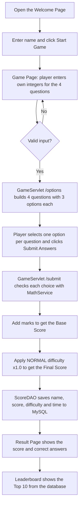

# SHAHARIAR – MATH WHIZ
 
This is my lab project for **Java Servlet & JDBC**. It's a small math game that runs in the browser. You type your name, pick your own numbers for four questions, then choose the right answer from three options. The server checks your choices and gives you a score out of 10. Every score goes into a MySQL database, and the best 10 show up on a leaderboard.
 
The questions cover three topics: prime numbers, modulus and trigonometry. None of the answers are stored anywhere. The server works each one out with real Java methods, both to build the options and to check your answer.
 
**Al-Shahariar** 

**ID: IT-24057**

Dept. of ICT, MBSTU

GitHub: [Shahariar6172](https://github.com/Shahariar6172)
 
---
 
## Project Objectives

- Build reusable Java methods for prime, modulus and trigonometry calculations.
- Check every answer with real Java calculations instead of stored answers.
- Handle requests and responses on the server with a Servlet.
- Save scores with JDBC and `PreparedStatement`, and read them back with SELECT.
- Show a Top 10 leaderboard sorted by score and date/time.

---

## Software Requirements

| Software | Version |
|---|---|
| JDK | 17 or newer |
| Apache Maven | 3.8+ |
| Apache Tomcat | 10.1.x |
| MySQL Server | 8.x (I used Laragon) |
| VS Code | with Extension Pack for Java |
| IntelliJ IDEA | 2026.1 or newer |

---

## What I Used
 
- **Java 17**, with Servlets and JSP (Jakarta EE)
- **Apache Tomcat 10.1.61** as the server
- **MySQL 8.4** running through **Laragon**, and **HeidiSQL** to look at the data
- **JDBC** (MySQL Connector/J) to connect Java to the database
- **Maven** to build the project
- **JUnit 5** for testing
- **VS Code** as my editor

---

## How the Project Is Organized
 
```
MathWhiz/
├── pom.xml                           # Maven config and dependencies
├── database/math_whiz_db.sql         # SQL to create the database
├── screenshots/                      # images used in this README
├── src/main/java/
│   ├── controller/GameServlet.java   # handles /start, /options, /submit and /leaderboard
│   ├── model/Question.java           # one question, its 3 options and how to check it
│   ├── model/GameScore.java          # one row from the scores table
│   ├── model/Difficulty.java         # difficulty level and its score multiplier
│   ├── service/MathService.java      # all the math methods
│   └── dao/ScoreDAO.java             # saving and reading scores (JDBC)
├── src/main/webapp/
│   ├── index.jsp                     # welcome page
│   ├── game.jsp                      # step 1: player enters the numbers
│   ├── options.jsp                   # step 2: player picks 1 of 3 options
│   ├── result.jsp                    # your score
│   ├── leaderboard.jsp               # top 10
│   └── css/style.css
└── src/test/java/service/MathServiceTest.java
```
 
I split the code into layers so each part has one job. The servlet only handles requests and pages. `MathService` only does math. `ScoreDAO` only talks to the database.
 
---
 
## How the Game Works (Workflow)

Here's what happens from the moment a player opens the page until their score shows up on the leaderboard.



Step by step:

1. **Open the game.** The browser loads `index.jsp`, the welcome page.
2. **Enter a name.** The player types a name and clicks **Start Game**. The form goes to `/start`, and the game randomly picks sin, cos or tan for Q3 and Q4.
3. **Enter your own numbers.** `game.jsp` asks the player for whole numbers: a number to check for Q1, `a` and `b` for Q2, and an angle (in degrees) for Q3 and Q4. Then the player clicks **Get Questions**, and the form goes to `/options`.
4. **Validate the input.** `GameServlet` accepts integers only. If the divisor is 0, or a tan angle is undefined (90°, 270° …), the page comes back with an error message and the player fixes it.
5. **Build the options.** For each question, the game calls the right `MathService` method to get the correct answer, then adds two wrong but believable answers and shuffles all three.
6. **Pick the answers.** `options.jsp` shows the four questions, each with three options. The player selects one per question and clicks **Submit Answers**. The form goes to `/submit`.
7. **Check each answer.** Each chosen option is compared with the answer from `MathService`. Decimals use a ±0.01 tolerance.
8. **Calculate the base score.** Correct answers add 2, 2, 3 and 3 marks.
9. **Apply the difficulty.** The base score is multiplied by the NORMAL multiplier (× 1.0) to get the final score.
10. **Save to the database.** `ScoreDAO` uses a `PreparedStatement` to insert the name, final score, difficulty and date/time into `game_scores`.
11. **Show the result.** `result.jsp` shows the final score, the calculation, and a table of every question with the player's choice and the correct answer.
12. **Show the leaderboard.** `/leaderboard` reads the top 10 scores (highest first, earlier player first on a tie) and shows them in `leaderboard.jsp`.

---

## Task 01 – Project Setup
 
I started with a Maven web project in VS Code, packaged as a `.war` file so Tomcat can run it. Since Tomcat 10 uses the newer `jakarta.*` packages, I used Servlet API 6.0. I also added MySQL Connector/J so Java can connect to the database.
 
```xml
<dependency>
    <groupId>jakarta.servlet</groupId>
    <artifactId>jakarta.servlet-api</artifactId>
    <version>6.0.0</version>
    <scope>provided</scope>
</dependency>
<dependency>
    <groupId>com.mysql</groupId>
    <artifactId>mysql-connector-j</artifactId>
    <version>8.4.0</version>
</dependency>
```
 
The servlet API is marked `provided` because Tomcat already ships with it, so it doesn't need to go into the war file.
 


---
 
## Task 02 – Designing the Interface
 
I wanted the game to be simple to use. There are four screens (the game screen has two steps):
 
- **Welcome page** – the title, a box for your name, and a Start Game button
- **Game page, step 1** – input boxes where the player enters their own integers for the four questions
- **Game page, step 2** – the four questions, each with three options to choose from, and a Submit Answers button
- **Result page** – your name, your total score, and a breakdown of every question with the correct answer
- **Leaderboard** – the top 10 players
The result page colors each row green or red, so you can see at a glance which answers you got wrong.
 


 
---
 
## Task 03 – Checking for Prime Numbers
 
The method returns `1` for a prime and `0` for anything else. Anything below 2 isn't prime, so that's checked first. After that, it only tries divisors up to the square root of the number. If a number has a factor bigger than its square root, the matching factor is smaller, so we would already have found it.
 
```java
public static int isPrime(int number) {
    if (number < 2) {
        return 0;
    }
    for (int i = 2; (long) i * i <= number; i++) {
        if (number % i == 0) {
            return 0;
        }
    }
    return 1;
}
```
 
I tested it with 7 (gives 1), 8 (gives 0), 1 (gives 0), 2 (gives 1) and 97 (gives 1).
 
---
 
## Task 04 – The Modulus Function
 
This one is mostly the `%` operator. The important part is dividing by zero. In C++ that would just crash, but here the method throws a clear error message instead.
 
```java
public static int calculateMod(int a, int b) {
    if (b == 0) {
        throw new IllegalArgumentException("Divisor cannot be zero");
    }
    return a % b;
}
```
 
One thing I learned while testing: in Java, the remainder takes the sign of the first number. So `-17 % 5` is `-2`, not `3`.
 
| Input | Result |
|---|---|
| 17 % 5 | 2 |
| -17 % 5 | -2 |
| 17 % -5 | 2 |
| 10 % 0 | error |
 
---
 
## Task 05 – Trigonometry
 
Java's `Math.sin()`, `Math.cos()` and `Math.tan()` expect radians, but people think in degrees. So every method converts the angle with `Math.toRadians()` first.
 
```java
public static double calculateSin(double degree) {
    return Math.sin(Math.toRadians(degree));
}
 
public static double calculateCos(double degree) {
    return Math.cos(Math.toRadians(degree));
}
 
public static double calculateTan(double degree) {
    double radian = Math.toRadians(degree);
    if (Math.abs(Math.cos(radian)) < 1e-10) {
        throw new ArithmeticException("tan(" + degree + "°) is undefined");
    }
    return Math.tan(radian);
}
```
 
Tangent needs extra care. At 90° and 270°, cos is zero, so tan is undefined. Because of floating-point rounding, `cos(90°)` in Java doesn't come out as exactly 0. It's something tiny like `6e-17`. That's why I check whether it's very close to zero instead of checking `== 0`.
 
To be sure sin and cos were correct, I also checked the identity **sin²θ + cos²θ = 1** (the unit circle, x² + y² = 1) for every angle from 0° to 360°.
 
Players type decimal answers like `0.7071`, so an exact match would be too strict. Any answer within **±0.01** of the real value counts as correct.
 
---
 
## Task 06 – Putting the Game Together
 
The player makes their own questions. On the game page they enter whole numbers:

- **Q1 – Prime:** any integer to check
- **Q2 – Modulus:** two integers, `a` and `b`
- **Q3 and Q4 – Trigonometry:** an angle in degrees. The game picks sin, cos or tan for each one at random when the game starts.

Before any question is made, the input is checked:

- Only integers are accepted. Text or decimals give an error.
- The divisor `b` must not be zero. This uses `calculateMod`, which throws an error for zero.
- For tan, an angle like 90° or 270° is undefined, so `calculateTan` throws an error and the player is asked for another angle.

If something is wrong, the same page comes back with a clear message and the numbers the player already typed.

Then each question builds **three options**: one correct answer worked out by `MathService`, plus two wrong ones:

| Question | Wrong options come from |
|---|---|
| Prime | the opposite answer (0 or 1) and -1 |
| Modulus | the quotient `a / b` instead of the remainder, or a number next to the right answer |
| Trigonometry | the other trig functions at the same angle (for example cos instead of sin), the negative value, or the value ± 0.5 |

The three options are shuffled, so the right one isn't always in the same place. The wrong options are always more than 0.01 away from the correct one, so only one option can count as correct.

```java
for (Question q : qs) {
    q.generateOptions(random);
}
```

The player selects one option per question. When the answers come back, each question checks the selected value by calling the right `MathService` method again.

| Question | Topic | Marks |
|---|---|---|
| Q1 | Prime number (1 = prime, 0 = not prime) | 2 |
| Q2 | Modulus | 2 |
| Q3 | Trigonometry | 3 |
| Q4 | Trigonometry | 3 |
| | **Total** | **10** |
 
Scoring happens in two steps. First I add up the marks exactly as the assignment says. That gives the **base score**:

```java
int baseScore = 0;

if (primeCorrect) baseScore += 2;
if (modCorrect)   baseScore += 2;
if (trig1Correct) baseScore += 3;
if (trig2Correct) baseScore += 3;
```

Then I apply the difficulty level to get the **final score** (see [Difficulty Level](#difficulty-level) below):

```java
int totalScore = DIFFICULTY.applyTo(baseScore);
```

After submitting, the questions are removed from the session, so the same game can't be submitted twice.

### Difficulty Level

Right now every question is at the same level, **NORMAL**, as the assignment asks. I still wanted the difficulty to actually mean something in the code, not just be a word saved in the database. So each level has a **score multiplier**, and the final score is calculated with it:

```
Final Score = round(Base Score × Multiplier)
```

| Difficulty | Prime | Modulus | Trigonometry | Multiplier | Max Final Score |
|---|---|---|---|---|---|
| NORMAL | NORMAL | NORMAL | NORMAL | × 1.0 | 10 |

The levels live in a small enum, `Difficulty.java`:

```java
public enum Difficulty {

    NORMAL(1.0);

    private final double multiplier;

    Difficulty(double multiplier) {
        this.multiplier = multiplier;
    }

    public int applyTo(int baseScore) {
        return (int) Math.round(baseScore * multiplier);
    }
}
```

A few examples with NORMAL:

| Correct answers | Base Score | × Multiplier | Final Score |
|---|---|---|---|
| All four | 10 | × 1.0 | **10** |
| Prime + Trig 1 + Trig 2 | 8 | × 1.0 | **8** |
| Modulus + Trig 1 | 5 | × 1.0 | **5** |
| None | 0 | × 1.0 | **0** |

Since NORMAL uses × 1.0, the maximum stays at 10 marks, exactly as the assignment requires. If I add a harder level later, I only need to add one line to the enum (for example `HARD(1.5)`) and the scoring code doesn't change.

The difficulty is shown on the game page, the result page shows the full calculation (`Base Score × Multiplier = Final Score`), and the level name is saved in the `difficulty` column with every score.
 
**Step 1 – the player enters their own numbers:**


**Step 2 – the player picks one of three options:**


**The result, with the difficulty calculation:**


 
---
 
## Task 07 – The Database
 
The database is called `math_whiz_db` and has one table, `game_scores`:
 
```sql
CREATE DATABASE IF NOT EXISTS math_whiz_db;
USE math_whiz_db;
 
CREATE TABLE IF NOT EXISTS game_scores (
    id          INT AUTO_INCREMENT PRIMARY KEY,
    player_name VARCHAR(100) NOT NULL,
    score       INT          NOT NULL,
    difficulty  VARCHAR(20)  NOT NULL DEFAULT 'NORMAL',
    played_at   TIMESTAMP    NOT NULL DEFAULT CURRENT_TIMESTAMP
);
```
 
Every score is saved together with its difficulty level (**NORMAL** for now). See [Difficulty Level](#difficulty-level) for how it affects the final score.
 
The connection details are in `ScoreDAO.java`. Laragon's MySQL root user has no password by default, so mine is empty:
 
```java
private static final String URL  = "jdbc:mysql://localhost:3306/math_whiz_db";
private static final String USER = "root";
private static final String PASS = "";
```
 
To save a score I used a `PreparedStatement`. Since the `?` placeholders are filled in separately, a player can't break the query (SQL injection) by typing something strange in the name box.
 
```java
String sql = "INSERT INTO game_scores (player_name, score, difficulty, played_at) VALUES (?, ?, ?, ?)";
try (Connection con = getConnection();
     PreparedStatement ps = con.prepareStatement(sql)) {
    ps.setString(1, gs.getPlayerName());
    ps.setInt(2, gs.getScore());
    ps.setString(3, gs.getDifficulty());
    ps.setTimestamp(4, gs.getPlayedAt());
    ps.executeUpdate();
}
```
 
The `try (...)` block closes the connection automatically when it's done, even if something goes wrong.
 
Here's what the saved scores look like in HeidiSQL:
 


 
---
 
## Task 08 – The Leaderboard
 
The leaderboard shows the 10 highest scores. If two players have the same score, the one who played first ranks higher.
 
```sql
SELECT *
FROM game_scores
ORDER BY score DESC, played_at ASC
LIMIT 10;
```
 
Each row shows the player's name, score, difficulty and when they played.
 


 
---
 
## Task 09 – Testing
 
I wrote JUnit tests for all the cases in the assignment, plus a few of my own (negative numbers, tan(90°), bad input, and the three options). To run them:
 
```
mvn test
```
 
| What I tested | Expected | Result |
|---|---|---|
| Is 7 prime? | 1 | Pass |
| Is 8 prime? | 0 | Pass |
| Is 1 prime? | 0 | Pass |
| 17 % 5 | 2 | Pass |
| sin(30°) | 0.5 | Pass |
| cos(60°) | 0.5 | Pass |
| tan(45°) | 1.0 | Pass |
| Divide by 0 | Error | Pass |
| All answers right | 10 marks | Pass |
| Wrong answers | No marks for those | Pass |
| 3 options per question | All different, exactly 1 correct | Pass |
 
All 15 tests passed:
 
```
Tests run: 15, Failures: 0, Errors: 0, Skipped: 0
```


  
---
 
## Task 10 – Documentation and Submission
 
The full project is on GitHub. It includes the source code, the database SQL file, this README and screenshots of every page.
 
**Project link:**
https://github.com/Shahariar6172/SHAHARIAR-MATH-WHIZ
 
---
 
## How to Run It Yourself
 
1. **Start MySQL.** Open Laragon and click **Start All**.
2. **Create the database.** In Laragon, click **Database** to open HeidiSQL. Paste the SQL from Task 07 into the Query tab and press **F9**.
3. **Check the password** in `ScoreDAO.java`. Leave it empty if you're using Laragon's default.
4. **Build the project** from the VS Code terminal:
```
   mvn clean package
```
5. **Copy the war file** into Tomcat:
```powershell
   copy target\MathWhiz.war D:\Downloads\apache-tomcat-10.1.61\webapps\
```
6. **Start Tomcat:**
```powershell
   $env:CATALINA_HOME="D:\Downloads\apache-tomcat-10.1.61"; & "$env:CATALINA_HOME\bin\startup.bat"
```
7. **Play.** Go to **http://localhost:8080/MathWhiz/**
8. **When you're done,** stop Tomcat:
```powershell
   & "$env:CATALINA_HOME\bin\shutdown.bat"
```
 
If you change any code, run `mvn clean package` again and copy the new war file over the old one.
 
---
 
## Screenshots

### Welcome Page


### Game Page – Step 1 (enter numbers)


### Game Page – Step 1 (numbers filled in)


### Game Page – Step 2 (choose an option)


### Result Page


### Leaderboard


### Database (HeidiSQL)


### Project Structure


---

## What I Learned
 
This project showed me how a full Java web application fits together. I learned how a browser request travels to a Servlet, how the Servlet passes data to a JSP page, and how JDBC saves and reads data from MySQL.

A few smaller lessons stood out too. Floating-point numbers are rarely exact, so decimal answers need a tolerance. Java's `%` keeps the sign of the first number. A `PreparedStatement` is safer than building SQL strings by hand. I also saw how splitting the code into controller, service, DAO and model layers makes each part easier to test and change.

---

