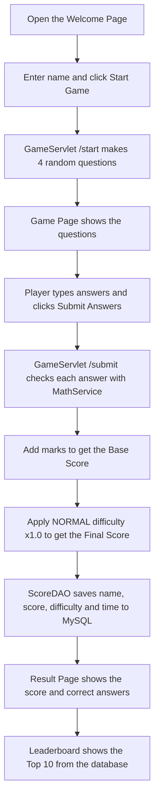

# SHAHARIAR – MATH WHIZ
 
This is my lab project for **Java Servlet & JDBC**. It's a small math game that runs in the browser. You type your name, answer four questions, and the server checks your answers and gives you a score out of 10. Every score goes into a MySQL database, and the best 10 show up on a leaderboard.
 
The questions cover three topics: prime numbers, modulus and trigonometry. None of the answers are stored anywhere. The server works each one out with real Java methods when it checks your answer.
 
**Al-Shahariar** 

**ID: IT-24057**

Dept. of ICT, MBSTU

GitHub: [Shahariar6172](https://github.com/Shahariar6172)
 
---
 
## What I Used
 
- **Java 17**, with Servlets and JSP (Jakarta EE)
- **Apache Tomcat 10.1.61** as the server
- **MySQL 8.4** running through **Laragon**, and **HeidiSQL** to look at the data
- **JDBC** (MySQL Connector/J) to connect Java to the database
- **Maven** to build the project
- **JUnit 5** for testing
- **VS Code** as my editor
## How the Project Is Organized
 
```
MathWhiz/
├── pom.xml                           # Maven config and dependencies
├── database/math_whiz_db.sql         # SQL to create the database
├── screenshots/                      # images used in this README
├── src/main/java/
│   ├── controller/GameServlet.java   # handles /start, /submit and /leaderboard
│   ├── model/Question.java           # one question and how to check it
│   ├── model/GameScore.java          # one row from the scores table
│   ├── model/Difficulty.java         # difficulty level and its score multiplier
│   ├── service/MathService.java      # all the math methods
│   └── dao/ScoreDAO.java             # saving and reading scores (JDBC)
├── src/main/webapp/
│   ├── index.jsp                     # welcome page
│   ├── game.jsp                      # the four questions
│   ├── result.jsp                    # your score
│   ├── leaderboard.jsp               # top 10
│   └── css/style.css
└── src/test/java/service/MathServiceTest.java
```
 
I split the code into layers so each part has one job. The servlet only handles requests and pages. `MathService` only does math. `ScoreDAO` only talks to the database.
 
---
 
## How the Game Works (Workflow)

Here's what happens from the moment a player opens the page until their score shows up on the leaderboard.



Step by step:

1. **Open the game.** The browser loads `index.jsp`, the welcome page.
2. **Enter a name.** The player types a name and clicks **Start Game**. The form goes to `/start`.
3. **Make the questions.** `GameServlet` checks that the name isn't empty, then creates four random questions: one prime, one modulus and two trigonometry. They're stored in the player's session.
4. **Show the questions.** `game.jsp` shows all four questions with an answer box for each, plus the difficulty (NORMAL).
5. **Submit the answers.** The player clicks **Submit Answers**, and the form goes to `/submit`.
6. **Check each answer.** Every question calls its `MathService` method (`isPrime`, `calculateMod`, `calculateSin`, `calculateCos` or `calculateTan`) to work out the real answer, then compares it with what the player typed. Decimals use a ±0.01 tolerance.
7. **Calculate the base score.** Correct answers add 2, 2, 3 and 3 marks.
8. **Apply the difficulty.** The base score is multiplied by the NORMAL multiplier (× 1.0) to get the final score.
9. **Save to the database.** `ScoreDAO` uses a `PreparedStatement` to insert the name, final score, difficulty and date/time into `game_scores`.
10. **Show the result.** `result.jsp` shows the final score, the calculation, and a table of every question with the player's answer and the correct one.
11. **Show the leaderboard.** `/leaderboard` reads the top 10 scores (highest first, earlier player first on a tie) and shows them in `leaderboard.jsp`.

---

## Task 01 – Project Setup
 
I started with a Maven web project in VS Code, packaged as a `.war` file so Tomcat can run it. Since Tomcat 10 uses the newer `jakarta.*` packages, I used Servlet API 6.0. I also added MySQL Connector/J so Java can connect to the database.
 
```xml
<dependency>
    <groupId>jakarta.servlet</groupId>
    <artifactId>jakarta.servlet-api</artifactId>
    <version>6.0.0</version>
    <scope>provided</scope>
</dependency>
<dependency>
    <groupId>com.mysql</groupId>
    <artifactId>mysql-connector-j</artifactId>
    <version>8.4.0</version>
</dependency>
```
 
The servlet API is marked `provided` because Tomcat already ships with it, so it doesn't need to go into the war file.
 


---
 
## Task 02 – Designing the Interface
 
I wanted the game to be simple to use. There are four pages:
 
- **Welcome page** – the title, a box for your name, and a Start Game button
- **Game page** – four questions, each with an answer box, and a Submit Answers button
- **Result page** – your name, your total score, and a breakdown of every question with the correct answer
- **Leaderboard** – the top 10 players
The result page colors each row green or red, so you can see at a glance which answers you got wrong.
 


 
---
 
## Task 03 – Checking for Prime Numbers
 
The method returns `1` for a prime and `0` for anything else. Anything below 2 isn't prime, so that's checked first. After that, it only tries divisors up to the square root of the number. If a number has a factor bigger than its square root, the matching factor is smaller, so we would already have found it.
 
```java
public static int isPrime(int number) {
    if (number < 2) {
        return 0;
    }
    for (int i = 2; (long) i * i <= number; i++) {
        if (number % i == 0) {
            return 0;
        }
    }
    return 1;
}
```
 
I tested it with 7 (gives 1), 8 (gives 0), 1 (gives 0), 2 (gives 1) and 97 (gives 1).
 
---
 
## Task 04 – The Modulus Function
 
This one is mostly the `%` operator. The important part is dividing by zero. In C++ that would just crash, but here the method throws a clear error message instead.
 
```java
public static int calculateMod(int a, int b) {
    if (b == 0) {
        throw new IllegalArgumentException("Divisor cannot be zero");
    }
    return a % b;
}
```
 
One thing I learned while testing: in Java, the remainder takes the sign of the first number. So `-17 % 5` is `-2`, not `3`.
 
| Input | Result |
|---|---|
| 17 % 5 | 2 |
| -17 % 5 | -2 |
| 17 % -5 | 2 |
| 10 % 0 | error |
 
---
 
## Task 05 – Trigonometry
 
Java's `Math.sin()`, `Math.cos()` and `Math.tan()` expect radians, but people think in degrees. So every method converts the angle with `Math.toRadians()` first.
 
```java
public static double calculateSin(double degree) {
    return Math.sin(Math.toRadians(degree));
}
 
public static double calculateCos(double degree) {
    return Math.cos(Math.toRadians(degree));
}
 
public static double calculateTan(double degree) {
    double radian = Math.toRadians(degree);
    if (Math.abs(Math.cos(radian)) < 1e-10) {
        throw new ArithmeticException("tan(" + degree + "°) is undefined");
    }
    return Math.tan(radian);
}
```
 
Tangent needs extra care. At 90° and 270°, cos is zero, so tan is undefined. Because of floating-point rounding, `cos(90°)` in Java doesn't come out as exactly 0. It's something tiny like `6e-17`. That's why I check whether it's very close to zero instead of checking `== 0`.
 
To be sure sin and cos were correct, I also checked the identity **sin²θ + cos²θ = 1** (the unit circle, x² + y² = 1) for every angle from 0° to 360°.
 
Players type decimal answers like `0.7071`, so an exact match would be too strict. Any answer within **±0.01** of the real value counts as correct.
 
---
 
## Task 06 – Putting the Game Together
 
When a game starts, the servlet makes four random questions:
 
- **Q1 – Prime:** a number from 1 to 100
- **Q2 – Modulus:** `a` from 10 to 99 and `b` from 2 to 12, so the divisor is never zero
- **Q3 and Q4 – Trigonometry:** a random sin, cos or tan with a common angle (0°, 30°, 45°, 60° and so on). Tan never gets 90° or 270°.
The questions are stored in the player's session. When the answers come back, each question checks itself by calling the right `MathService` method. If someone types something that isn't a number, like `abc`, that answer is simply marked wrong.
 
| Question | Topic | Marks |
|---|---|---|
| Q1 | Prime number (1 = prime, 0 = not prime) | 2 |
| Q2 | Modulus | 2 |
| Q3 | Trigonometry | 3 |
| Q4 | Trigonometry | 3 |
| | **Total** | **10** |
 
Scoring happens in two steps. First I add up the marks exactly as the assignment says. That gives the **base score**:

```java
int baseScore = 0;

if (primeCorrect) baseScore += 2;
if (modCorrect)   baseScore += 2;
if (trig1Correct) baseScore += 3;
if (trig2Correct) baseScore += 3;
```

Then I apply the difficulty level to get the **final score** (see [Difficulty Level](#difficulty-level) below):

```java
int totalScore = DIFFICULTY.applyTo(baseScore);
```

After submitting, the questions are removed from the session, so the same game can't be submitted twice.

### Difficulty Level

Right now every question is at the same level, **NORMAL**, as the assignment asks. I still wanted the difficulty to actually mean something in the code, not just be a word saved in the database. So each level has a **score multiplier**, and the final score is calculated with it:

```
Final Score = round(Base Score × Multiplier)
```

| Difficulty | Prime | Modulus | Trigonometry | Multiplier | Max Final Score |
|---|---|---|---|---|---|
| NORMAL | NORMAL | NORMAL | NORMAL | × 1.0 | 10 |

The levels live in a small enum, `Difficulty.java`:

```java
public enum Difficulty {

    NORMAL(1.0);

    private final double multiplier;

    Difficulty(double multiplier) {
        this.multiplier = multiplier;
    }

    public int applyTo(int baseScore) {
        return (int) Math.round(baseScore * multiplier);
    }
}
```

A few examples with NORMAL:

| Correct answers | Base Score | × Multiplier | Final Score |
|---|---|---|---|
| All four | 10 | × 1.0 | **10** |
| Prime + Trig 1 + Trig 2 | 8 | × 1.0 | **8** |
| Modulus + Trig 1 | 5 | × 1.0 | **5** |
| None | 0 | × 1.0 | **0** |

Since NORMAL uses × 1.0, the maximum stays at 10 marks, exactly as the assignment requires. If I add a harder level later, I only need to add one line to the enum (for example `HARD(1.5)`) and the scoring code doesn't change.

The difficulty is shown on the game page, the result page shows the full calculation (`Base Score × Multiplier = Final Score`), and the level name is saved in the `difficulty` column with every score.
 


 


 
---
 
## Task 07 – The Database
 
The database is called `math_whiz_db` and has one table, `game_scores`:
 
```sql
CREATE DATABASE IF NOT EXISTS math_whiz_db;
USE math_whiz_db;
 
CREATE TABLE IF NOT EXISTS game_scores (
    id          INT AUTO_INCREMENT PRIMARY KEY,
    player_name VARCHAR(100) NOT NULL,
    score       INT          NOT NULL,
    difficulty  VARCHAR(20)  NOT NULL DEFAULT 'NORMAL',
    played_at   TIMESTAMP    NOT NULL DEFAULT CURRENT_TIMESTAMP
);
```
 
Every score is saved together with its difficulty level (**NORMAL** for now). See [Difficulty Level](#difficulty-level) for how it affects the final score.
 
The connection details are in `ScoreDAO.java`. Laragon's MySQL root user has no password by default, so mine is empty:
 
```java
private static final String URL  = "jdbc:mysql://localhost:3306/math_whiz_db";
private static final String USER = "root";
private static final String PASS = "";
```
 
To save a score I used a `PreparedStatement`. Since the `?` placeholders are filled in separately, a player can't break the query (SQL injection) by typing something strange in the name box.
 
```java
String sql = "INSERT INTO game_scores (player_name, score, difficulty, played_at) VALUES (?, ?, ?, ?)";
try (Connection con = getConnection();
     PreparedStatement ps = con.prepareStatement(sql)) {
    ps.setString(1, gs.getPlayerName());
    ps.setInt(2, gs.getScore());
    ps.setString(3, gs.getDifficulty());
    ps.setTimestamp(4, gs.getPlayedAt());
    ps.executeUpdate();
}
```
 
The `try (...)` block closes the connection automatically when it's done, even if something goes wrong.
 
Here's what the saved scores look like in HeidiSQL:
 


 
---
 
## Task 08 – The Leaderboard
 
The leaderboard shows the 10 highest scores. If two players have the same score, the one who played first ranks higher.
 
```sql
SELECT *
FROM game_scores
ORDER BY score DESC, played_at ASC
LIMIT 10;
```
 
Each row shows the player's name, score, difficulty and when they played.
 


 
---
 
## Task 09 – Testing
 
I wrote JUnit tests for all the cases in the assignment, plus a few of my own (negative numbers, tan(90°), bad input). To run them:
 
```
mvn test
```
 
| What I tested | Expected | Result |
|---|---|---|
| Is 7 prime? | 1 | Pass |
| Is 8 prime? | 0 | Pass |
| Is 1 prime? | 0 | Pass |
| 17 % 5 | 2 | Pass |
| sin(30°) | 0.5 | Pass |
| cos(60°) | 0.5 | Pass |
| tan(45°) | 1.0 | Pass |
| Divide by 0 | Error | Pass |
| All answers right | 10 marks | Pass |
| Wrong answers | No marks for those | Pass |
 
All 14 tests passed:
 
```
Tests run: 14, Failures: 0, Errors: 0, Skipped: 0
```


  
---
 
## Task 10 – Documentation and Submission
 
The full project is on GitHub. It includes the source code, the database SQL file, this README and screenshots of every page.
 
**Project link:**
https://github.com/Shahariar6172/SHAHARIAR-MATH-WHIZ
 
---
 
## How to Run It Yourself
 
1. **Start MySQL.** Open Laragon and click **Start All**.
2. **Create the database.** In Laragon, click **Database** to open HeidiSQL. Paste the SQL from Task 07 into the Query tab and press **F9**.
3. **Check the password** in `ScoreDAO.java`. Leave it empty if you're using Laragon's default.
4. **Build the project** from the VS Code terminal:
```
   mvn clean package
```
5. **Copy the war file** into Tomcat:
```powershell
   copy target\MathWhiz.war D:\Downloads\apache-tomcat-10.1.61\webapps\
```
6. **Start Tomcat:**
```powershell
   $env:CATALINA_HOME="D:\Downloads\apache-tomcat-10.1.61"; & "$env:CATALINA_HOME\bin\startup.bat"
```
7. **Play.** Go to **http://localhost:8080/MathWhiz/**
8. **When you're done,** stop Tomcat:
```powershell
   & "$env:CATALINA_HOME\bin\shutdown.bat"
```
 
If you change any code, run `mvn clean package` again and copy the new war file over the old one.
 
---
 
## Screenshots
 
### Welcome Page


 
### Game Page


 
### Result Page


 
### Leaderboard


 
### Database (HeidiSQL)


 
### Test Results


 
---
 
## What I Learned
 
Before this project I only knew C++. Building this taught me how a browser request reaches a Servlet, how JSP pages show data from Java, and how to save and read data with JDBC. It also taught me a few things that are easy to miss: floating-point numbers are never exactly what you expect, Java's `%` keeps the sign of the first number, and using `PreparedStatement` instead of building SQL strings by hand is safer.

---

